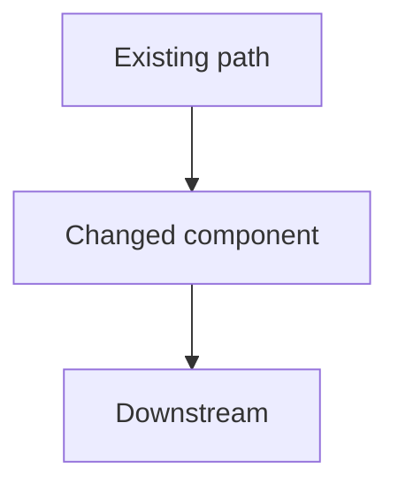

# Git and PR Workflow

## Branch Safety

Before changing files:

- inspect current branch;
- inspect working tree;
- inspect existing uncommitted changes;
- never overwrite unrelated user work.

Do not reset, checkout, clean, stash, or otherwise destroy user changes unless explicitly authorized.

Prefer creating a feature/fix branch when the repository workflow requires it.

## Diff Discipline

A commit must contain only related changes.

Before commit:

- inspect `git status`;
- inspect staged diff;
- inspect unstaged diff;
- remove accidental changes;
- verify generated files are intentional;
- verify no secrets are included.

Never commit:
- `.env` secrets;
- private keys;
- credentials;
- tokens;
- unrelated local files.

## Conventional Commits

Use:

`type(scope): description`

Allowed common types:

- `feat`
- `fix`
- `refactor`
- `test`
- `docs`
- `perf`
- `build`
- `ci`
- `chore`
- `revert`

Examples:

`feat(auth): add refresh token rotation`

`fix(worker): prevent duplicate job execution`

`refactor(db): isolate transaction boundary`

Scope should identify the domain/package/subsystem.

### Message shape

Default:

```text
type(scope): imperative summary (≤72 chars)

What: ...
Why: ...
Impact: ...
```

Keep it scannable: one or two short paragraphs, or three bullets. State what
changed, why, and the user-visible or behavioral consequence the subject
cannot carry. Do not narrate the diff or include plan artifacts.

Every commit — lead, worker, or subagent — carries a body. A subject-only or
ambiguous message is a defect; amend before pushing.

## Commit Strategy

A behavior change and the tests that prove it are one commit. Do not commit the
red test first and the implementation second, and do not commit the
implementation first and the tests second. Commit once per behavior change, at
green, with both.

Before `git commit`:

- `git status` — stage the implementation and its test changes together.
- `git diff --cached --stat` — a behavior commit with no test change is a
  defect unless the change is docs/config or the TDD skip was stated.
- `git diff --cached` — confirm the tests exercise the committed behavior.
- A `test:`-only commit is valid only for pre-existing behavior or test debt,
  never for a feature in the same change.

Prefer coherent commits; do not create dozens of meaningless commits.

Do not amend/rewrite history that the user may already have pushed unless explicitly requested.

## Pull Requests

PR title: a concise Conventional Commit-style title.

Every body starts with a TL;DR: what changed, why, and the impact in at most
three bullets. A reader who stops there should still understand the change.
Link changed files, design docs, dashboards, and source references; do not type
bare paths.

Default body for a small or standard change:

````markdown
## TL;DR
- What changed, why, and the impact (≤3 bullets)

## Context
- Problem, constraint, and chosen approach; link the issue or design doc.
  Only what a reviewer needs to judge the change.

## Diagram
<!-- Required when a reviewer would need to reconstruct a call path, data
flow, or state transition from the diff. Skip for docs, chore, dependency
bumps, typos, and self-evident local fixes. -->



1–3 sentences: what changed and why the shape matters.

## Testing
- Exact commands/checks and results, one line per acceptance criterion:
  `criterion → command → result`

## Risks / Rollback
- Failure modes, rollout/flag, rollback; non-trivial changes only
````

Diagram rules: show only the affected slice, mark new or changed nodes
(`classDef changed`), keep it under ~10 nodes, top-down, short labels. Never
diagram the diff.

High-impact changes add Implementation decisions, migration/rollout notes, and
a reviewer guide (where to start, open questions).

Scale the body to the change. Do not restate the diff, paste raw logs, or
repeat the commit body. A reviewer should get what, why, context, evidence,
and risk in under a minute. Agents use the same structure: exact paths,
commands, and known gaps, not prose.

## Stacked PRs

A stack is two or more PRs in the same repository: the bottom targets the
trunk (`master`/`main`), and each higher PR targets the branch below it.

When a PR depends on another unmerged PR, use GitHub's native stack feature.
Never emulate a stack by only setting a child PR's base to a feature branch;
GitHub records that as an ordinary PR (`stack: null`).

- New chain: `gh stack init [--base <trunk>] <bottom> <next> ...`, then
  `gh stack submit`.
- Existing branches or PRs: `gh stack link <bottom> <next> ...`, bottom first.
- Verify before review: `gh stack view` or
  `gh api repos/{owner}/{repo}/pulls/<n> --jq '.stack'`. `null` is a defect.

Native stacks evaluate branch protection, required checks, CODEOWNERS, code
scanning, and required deployments against the stack trunk for every layer.
They cascade rebases, preserve approvals for unchanged layer diffs, retarget
upper PRs when the bottom merges, and merge bottom-up (whole or partial,
merge-queue aware). Do not close
and recreate upper PRs after the bottom merges; sync or rebase the stack.

A manual chain is stranded when its base branch is deleted: the child keeps a
missing base, reports `mergeable: false`, and needs a manual retarget and
rebase. A squash-merged bottom also leaves its original commits in the child,
so reopening the child against the trunk shows both layers until rebased.

Limitations: all branches must be in the same repository; cross-fork stacks and
GitHub Desktop are unsupported.

## CI

Before opening the PR:

- run the repository's own validation entrypoint end-to-end — the CI job's
  commands, `ci/run_validation.sh`, `make check`, or equivalent — not only the
  tests for the files you changed;
- changed-file checks miss cross-module regressions: shared fixtures,
  import-time stubs, plugin/loader paths, global registration;
- if the full gate is CI-only, reproduce its exact command locally or wait for
  it before claiming integration.

After PR creation:

- wait for required checks;
- inspect failures rather than guessing;
- reproduce locally when practical;
- fix failures;
- rerun local verification;
- push;
- wait again.

A PR with red required CI is not complete.

Never weaken or bypass tests merely to make CI green.

## Merge

Merge when the user's request authorizes it, or when standing authorization
applies: after the review round and green required CI. Squash and delete the
branch by default. A repository's `AGENTS.md` may require an explicit ask
instead; follow it. Never merge directly to `main` and never force-push. If
merge fails, fix forward or report the blocker.

When a merge triggers deployment or infrastructure pipelines, verify those
post-merge pipelines before reporting completion. A green PR check alone is not
completion for deploy-coupled changes.
