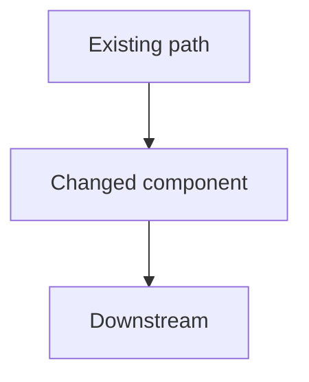

# Git and PR Workflow

## Branch Safety

Before changing files:

- inspect current branch;
- inspect working tree;
- inspect existing uncommitted changes;
- never overwrite unrelated user work.

Do not reset, checkout, clean, stash, or otherwise destroy user changes unless explicitly authorized.

Prefer creating a feature/fix branch when the repository workflow requires it.

## Worktrees

Sequential work uses a branch, not a worktree. When two agents can write to
the same repository at once, each gets its own worktree and branch:
`git worktree add <path> -b agent/<scope> <base>`. Already inside one: work
there.

- Before dispatch: a clean or deliberately preserved base, passing tests, and
  tasks split by file ownership with their dependencies named. Do not
  parallelize tightly coupled edits. Give each agent its worktree path,
  branch, and the files it owns.
- Each agent works only in its worktree, commits there, and reports its SHA;
  it never resets, cleans, or edits another agent's worktree or branch.
- Worktrees isolate files, not resources: serialize or isolate shared
  databases, generated artifacts, lockfiles, deploy environments, and cloud
  resources.
- Before integrating, review each branch and run its tests. Integrate in
  dependency order, resolve conflicts deliberately (never blind
  cherry-picks), and run the full validation after integration. Independent
  changes may ship as separate PRs.
- Remove a worktree (`git worktree remove`, then `git worktree prune`) only
  after its work is merged. A stuck agent's worktree is preserved and
  inspected before reassignment.

## Diff Discipline

A commit must contain only related changes.

Before commit:

- inspect `git status`;
- inspect staged diff;
- inspect unstaged diff;
- remove accidental changes;
- verify generated files are intentional;
- verify no secrets are included.

Never commit:
- `.env` secrets;
- private keys;
- credentials;
- tokens;
- unrelated local files.

## Conventional Commits

Use:

`type(scope): description`

Allowed common types:

- `feat`
- `fix`
- `refactor`
- `test`
- `docs`
- `perf`
- `build`
- `ci`
- `chore`
- `revert`

Examples:

`feat(auth): add refresh token rotation`

`fix(worker): prevent duplicate job execution`

`refactor(db): isolate transaction boundary`

Scope should identify the domain/package/subsystem.

### Message shape

Default:

```text
type(scope): imperative summary (≤72 chars)

What: ...
Why: ...
Impact: ...
```

Keep it scannable: one or two short paragraphs, or three bullets. State what
changed, why, and the user-visible or behavioral consequence the subject
cannot carry. Do not narrate the diff or include plan artifacts.

Every commit — lead, worker, or subagent — carries a body. A subject-only or
ambiguous message is a defect; amend before pushing.

## Commit Strategy

A behavior change and the tests that prove it are one commit. Do not commit the
red test first and the implementation second, and do not commit the
implementation first and the tests second. Commit once per behavior change, at
green, with both.

Before `git commit`:

- `git status` — stage the implementation and its test changes together.
- `git diff --cached --stat` — a behavior commit with no test change is a
  defect unless the change is docs/config or the `testing` skip was stated.
- `git diff --cached` — confirm the tests exercise the committed behavior.
- A `test:`-only commit is valid only for pre-existing behavior or test debt,
  never for a feature in the same change.

Prefer coherent commits; do not create dozens of meaningless commits.

Do not amend/rewrite history that the user may already have pushed unless explicitly requested.

## Pull Requests

PR title: a concise Conventional Commit-style title.

If the PR depends on another unmerged PR, it is a stack layer; follow Stacked
PRs and open it through the native stack.

Every body starts with a TL;DR: what changed, why, and the impact in at most
three bullets. A reader who stops there should still understand the change.
Link changed files, design docs, dashboards, and source references; do not type
bare paths.

Default body for a small or standard change:

````markdown
## TL;DR
- What changed, why, and the impact (≤3 bullets)

## Context
- Problem, constraint, and chosen approach; link the issue or design doc.
  Only what a reviewer needs to judge the change.

## Diagram
<!-- Required when a reviewer would need to reconstruct a call path, data
flow, or state transition from the diff. Skip for docs, chore, dependency
bumps, typos, and self-evident local fixes. -->



1–3 sentences: what changed and why the shape matters.

## Testing
- Exact commands/checks and results, one line per acceptance criterion:
  `criterion → command → result`
- Seam evidence when the change has a consumer: exact rendered unit, composed
  request/limiter count, consumer-field round trip, or provider-status matrix.
  Coverage percentages and whole-panel text matches are not seam evidence.
- The `testing` finalize audit evidence block, including the report-only
  findings outside the diff.

## Risks / Rollback
- Failure modes, rollout/flag, rollback; non-trivial changes only
````

Diagram rules: show only the affected slice, mark new or changed nodes
(`classDef changed`), keep it under ~10 nodes, top-down, short labels. Never
diagram the diff.

High-impact changes add Implementation decisions, migration/rollout notes, and
a reviewer guide (where to start, open questions).

Scale the body to the change. Do not restate the diff, paste raw logs, or
repeat the commit body. A reviewer should get what, why, context, evidence,
and risk in under a minute. Agents use the same structure: exact paths,
commands, and known gaps, not prose.

## Stacked PRs

A stack is two or more PRs in the same repository: the bottom targets the
trunk (`main`/`master`), and each higher PR targets the branch below it.

When a PR depends on another unmerged PR, use GitHub's native stack feature.
Never emulate a stack by setting a child PR's base to a feature branch: GitHub
records that as an ordinary PR (`stack: null`), and the chain strands when a
base branch is deleted. A single dependent PR still belongs in a native stack.

Preflight: `gh stack --help`. If the extension is missing, run
`gh extension install github/gh-stack`. If stacks are unavailable for the
repository (for example cross-fork work), stop and report the blocker; do not
build a manual chain.

- New chain: `gh stack init --base <trunk> <bottom>`, commit the bottom layer,
  then `gh stack add <next>` and commit each higher layer; finish with
  `gh stack submit --auto`. Add `--open` when the PRs are ready for review,
  then replace each placeholder title and body with `gh pr edit <n> --title
  '<type(scope): summary>' --body-file <file>`.
- Adopting existing branches: `gh stack init <bottom> <next> ...`, then
  `gh stack submit --auto`; submit updates existing PRs' bases.
- Existing correctly chained PRs: `gh stack link <bottom> <next> ...`, bottom
  first (PR numbers and URLs also accepted). Adopt a manual chain this way
  instead of extending it.
- Never create or retarget a stack layer with `gh pr create --base
  <feature-branch>` or `gh pr edit --base`.

Verify before review: `gh stack view --json`, or
`gh api repos/{owner}/{repo}/pulls/<n> --jq '.stack'`. `null` on a dependent
PR is a defect; fix it with `gh stack link` before asking for review.

Native stacks evaluate branch protection, required checks, CODEOWNERS, code
scanning, and required deployments against the stack trunk for every layer.
They cascade rebases, preserve approvals for unchanged layer diffs, and
retarget upper PRs when the bottom merges. After a bottom merge run
`gh stack sync` (or `gh stack rebase`); never close and recreate upper PRs.

Limitations: all branches must be in the same repository; cross-fork stacks and
GitHub Desktop are unsupported.

## CI

Before opening the PR:

- run the repository's own validation entrypoint end-to-end — the CI job's
  commands, `ci/run_validation.sh`, `make check`, or equivalent — not only the
  tests for the files you changed;
- changed-file checks miss cross-module regressions: shared fixtures,
  import-time stubs, plugin/loader paths, global registration;
- if the full gate is CI-only, reproduce its exact command locally or wait for
  it before claiming integration.

After PR creation:

- wait for required checks with a bounded wait on the workflow runs for the
  head commit, never an unbounded `gh pr checks --watch` (it waits forever on
  a check GitHub leaves `in_progress` after its job finished):

  ```bash
  # Run from the repository checkout; `timeout` is GNU coreutils.
  sha=$(gh pr view <n> --json headRefOid -q .headRefOid) && [ -n "$sha" ] || exit 1
  runs=$(gh run list --commit "$sha" --limit 100 --json databaseId -q '.[].databaseId') || exit 1
  [ -n "$runs" ] || { echo "no workflow run yet for $sha" >&2; exit 1; }
  rc=0
  while read -r run; do
    timeout 1800 gh run watch "$run" --exit-status < /dev/null || rc=$?
  done <<< "$runs"
  checks=$(gh api --paginate "repos/{owner}/{repo}/commits/$sha/check-runs?per_page=100" \
    -q '.check_runs[] | "\(.name) \(.status) \(.conclusion)"') || exit 1
  [ -n "$checks" ] || { echo "no check runs for $sha" >&2; exit 1; }
  echo "$checks"
  exit "$rc"
  ```

  Green means exit 0 and every listed check concluded `success`, `skipped` or
  `neutral`. Empty output or a non-zero exit is not green: no run yet means
  wait briefly and rerun; 124 means a run is still going after 30 minutes, so
  report it with the check list instead of waiting again. A check run with a
  `conclusion` is finished even if its `status` still says `in_progress`;
- inspect failures rather than guessing;
- reproduce locally when practical;
- fix failures;
- rerun local verification;
- push;
- wait again.

A PR with red required CI is not complete.

Never weaken or bypass tests merely to make CI green.

## Merge

Merge when the user's request authorizes it, or when standing authorization
applies: after the required review lane (or a recorded skip) and green required
CI. Squash and delete the branch by default for a standalone PR. A repository's
`AGENTS.md` may require an explicit ask instead; follow it. Never merge directly
to `main` and never force-push. If merge fails, fix forward or report the
blocker.

Merge a stack as one unit. For the checked-out stack:
`gh stack merge --yes --squash`. To stop at a layer, pass its PR number, but a
bare number resolves as a stack number first; confirm the target with
`gh stack view --json` and `gh api repos/{owner}/{repo}/stacks` before using
`--yes`. Never `gh pr merge` a stack layer — the legacy merge endpoint cannot
merge a stack — and never merge layers one at a time by hand. After a bottom
merge, sync the remaining stack rather than closing and recreating PRs.

Before deleting a merged branch, `gh pr list --base <branch>` must be empty:
deleting a branch that an open PR targets closes that PR. Delete layer branches
only after the whole stack is merged.

When a merge triggers deployment or infrastructure pipelines, verify those
post-merge pipelines before reporting completion. A green PR check alone is not
completion for deploy-coupled changes.
