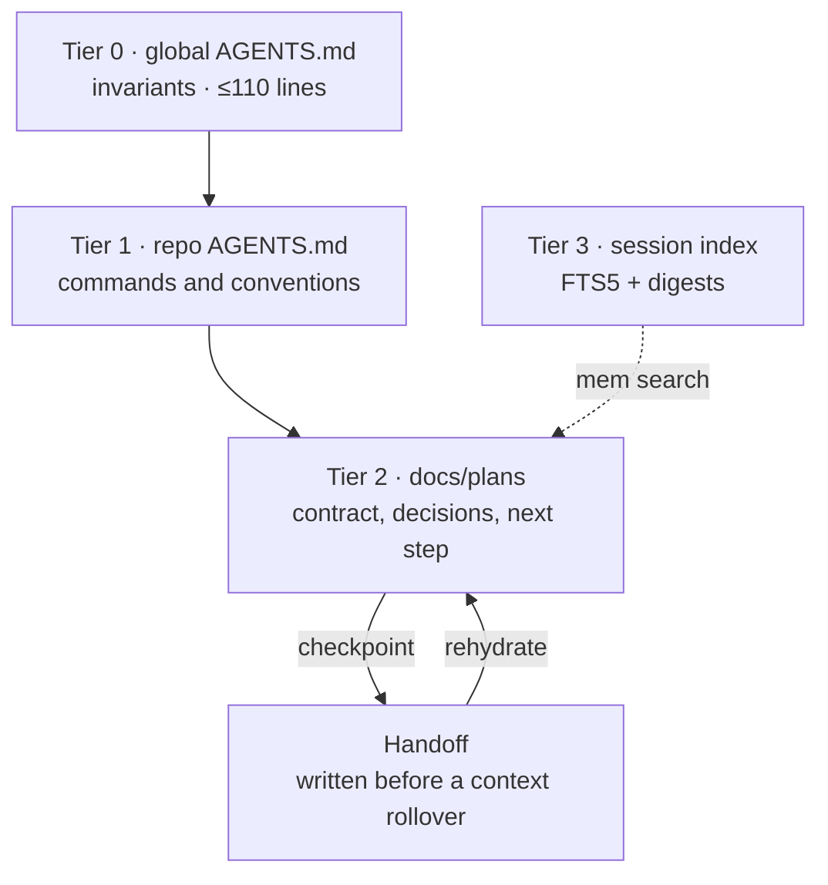

# Agent memory: setup and recovery

The memory system is four tiers of files plus a local search index. It works
on any machine that clones this dotfiles repository; nothing is stored in the
repository except the skills and this guide.



Tier 0 is always loaded. Tier 1 loads per repository. Tier 2 is the active task
state. Tier 3 is queried, never injected. OpenCode reads
`~/.config/opencode/AGENTS.md`; Codex reads `~/.codex/AGENTS.md`. Both are
linked from this repository.

## New machine

1. Clone and install:

   ```sh
   git clone <dotfiles-remote> ~/dotfiles
   cd ~/dotfiles
   ./install.sh
   ```

2. Verify the links:

   ```sh
   ls ~/.config/opencode/AGENTS.md
   ls ~/.agents/skills/grilling/SKILL.md
   ls ~/.agents/skills/handoff/scripts/session-handoff
   ls ~/.agents/skills/memory/scripts/mem
   ```

3. Build the index:

   ```sh
   ~/.agents/skills/memory/scripts/mem index
   ~/.agents/skills/memory/scripts/mem stats
   ```

4. Smoke-test recall:

   ```sh
   ~/.agents/skills/memory/scripts/mem search "merge conflict" --limit 5
   ```

5. Confirm automatic compaction is off in `~/.config/opencode/opencode.json`:

   ```json
   "compaction": {
     "auto": false
   }
   ```

   Sessions stop at the model's context limit instead of being summarized.
   Write a handoff with `mem handoff` and continue in a new session before
   reaching that limit. The file is linked from the repository, so a
   `git pull` updates it. Restart the OpenCode service after changing it.

## Context rollover

Compaction is off. Before the window fills, write a handoff and continue in a
fresh session:

```sh
~/.agents/skills/handoff/scripts/session-handoff path --task "short title"
~/.agents/skills/handoff/scripts/session-handoff start --handoff <path>
```

`start` exports the full transcript, appends session pointers to the handoff,
creates a successor session with the same agent and model, and seeds it with
the handoff path. The old session stays intact.

The `context-rollover` plugin warns the agent at 80% and 90% of the model
window. `/handoff` runs the same flow on demand. A handoff is also the right
move at the end of a long task or before switching agents.

## Per-repository setup

Each active repository gets a small `AGENTS.md`:

```markdown
# <repo> — agent notes

## Commands
- test:
- lint:
- typecheck/build:

## Conventions
- ...

## Gotchas
- ...
```

Keep it under ~80 lines. Project-specific rules belong here, not in the global
file. Put multi-step plans under `docs/plans/YYYY-MM-DD-<task>.md`.

MCP servers are no longer global. Add only what the repository needs in
`.opencode/opencode.json`:

```json
{
  "mcp": {
    "servers": {
      "atlassian": {
        "type": "remote",
        "url": "https://mcp.atlassian.com/v2/mcp"
      }
    }
  }
}
```

OAuth credentials stay in the per-profile auth store; never commit them.

## Daily protocol

| Moment | Action |
|---|---|
| Start | Read Tier 0, the repo `AGENTS.md`, and the active plan. |
| Checkpoint | Update the plan and handoff: decisions, files, commands, next. |
| At ~80% context | Refresh the handoff with `mem handoff` or a direct edit. |
| New session | Re-read the handoff and plan before continuing. |
| Session end | Write a digest and run `mem index`. |
| Task done | Start a new session; do not carry a finished task forward. |

One session per task or phase. A session that needs more than one handoff is a
sign the task should have been split.

## Skill usage review

The agent announces "Using [skill]" when it loads one. Search the index weekly:

```sh
~/.agents/skills/memory/scripts/mem search "Using "
```

A skill that never appears is mis-described or redundant; a skill that appears
on every task is over-broad. Retune the description or fold the skill. Do not
fix under-triggering by loading everything — that consumes context without
improving routing.

## Handoff template

```markdown
# Handoff — <task>
Date:
Repo:
Branch:
Goal:
State: done | in progress | blocked
Decisions: what + why
Files: exact paths
Commands: worked / failed
Next: one next action
Open questions:
```

## Troubleshooting

| Symptom | Fix |
|---|---|
| `OpenCode database not found` | Set `OPENCODE_DB` or confirm `~/.local/share/opencode/opencode.db` exists. |
| Search returns nothing | Run `mem index` explicitly, then retry. |
| Index is stale | It rebuilds when the database or WAL mtime changes; run `mem index` to force. |
| `no such table: messages` | Delete `~/.local/share/agent-memory/index.db` and re-run `mem index`. |
| FTS5 unavailable | Use a Python build with FTS5 enabled; the macOS system Python normally has it. |

## Privacy

The index contains prompts, responses, and tool output from local sessions. It
lives under `~/.local/share/agent-memory` with mode `0700` and is never
committed. Do not sync it to a shared drive. Handoffs are ordinary Markdown and
should be reviewed before sharing.
