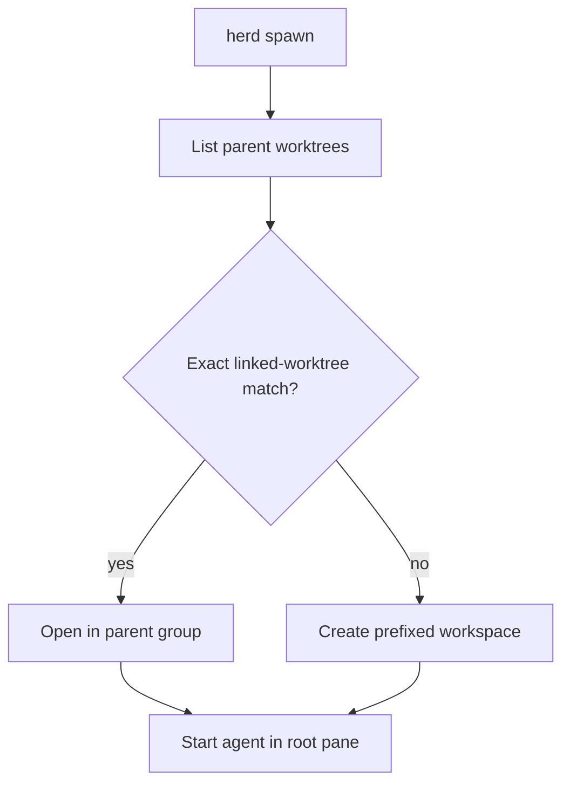

# Native Worktree Grouping for Herd Workers

## Goal

Show worker workspaces under their repository workspace in Herdr when the worker checkout is an existing linked Git worktree.

## Context

`herd spawn` currently calls `herdr workspace create` for every worker. That creates a standalone workspace with a parent-prefixed label, even when the worker's `cwd` is a linked worktree belonging to the parent repository. Herdr 0.9.3 already supports grouping such checkouts through `herdr worktree open`; this also records worktree membership when the checkout is already open. Arbitrary non-worktree workspaces still have no parent-child relationship.

## Design

For a spawn path that exactly matches a linked worktree returned by `herdr worktree list --workspace "$parent_ws"`, call `herdr worktree open --workspace "$parent_ws" --path "$cwd" --label "$name" --no-focus`. Use its returned workspace and root pane, then start the agent there. The worker name is the child label; Herdr's worktree group conveys the parent.

If the path is not a matching linked worktree, retain the existing behavior: create a separate workspace labeled `<parent>/<worker>`. This preserves support for ordinary directories and avoids pretending that arbitrary workspace nesting exists.

On agent-start failure, close a workspace only if this invocation created it. `worktree open` reports `already_open`; an existing workspace must remain open even if agent startup fails. Existing workers in the default session will be grouped by opening their current linked checkouts against the repo's parent workspace, without restarting their agents or changing Git checkouts.

Matching linked checkouts receive Herdr's native worktree grouping; all other paths keep the flat, prefixed-label fallback. Both paths remain isolated workspaces and avoid splitting the lead's pane.

## Scope and verification

- Update `herd spawn`, its shell test, and the herd playbook to reflect native worktree grouping plus the fallback.
- Test linked-worktree selection, fallback creation, and safe cleanup for newly created versus already-open workspaces.
- Register the two existing worker checkouts in the default Herdr session under the parent repository workspace; verify each workspace exposes worktree provenance and the agents remain running.
- No Herdr restart, binary update, Git checkout changes, or worker process restart is required.
